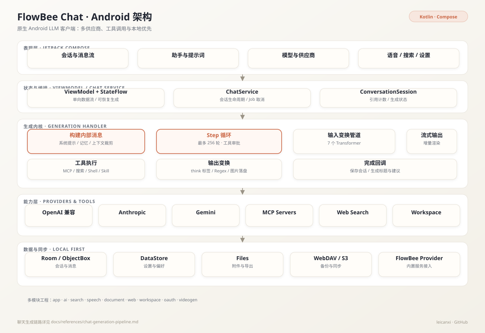
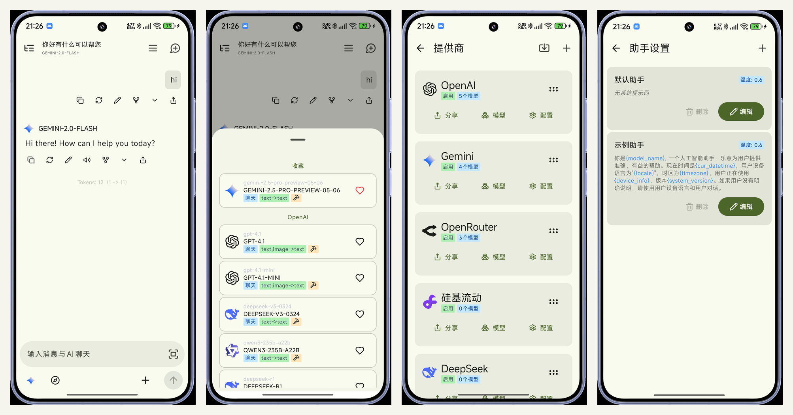
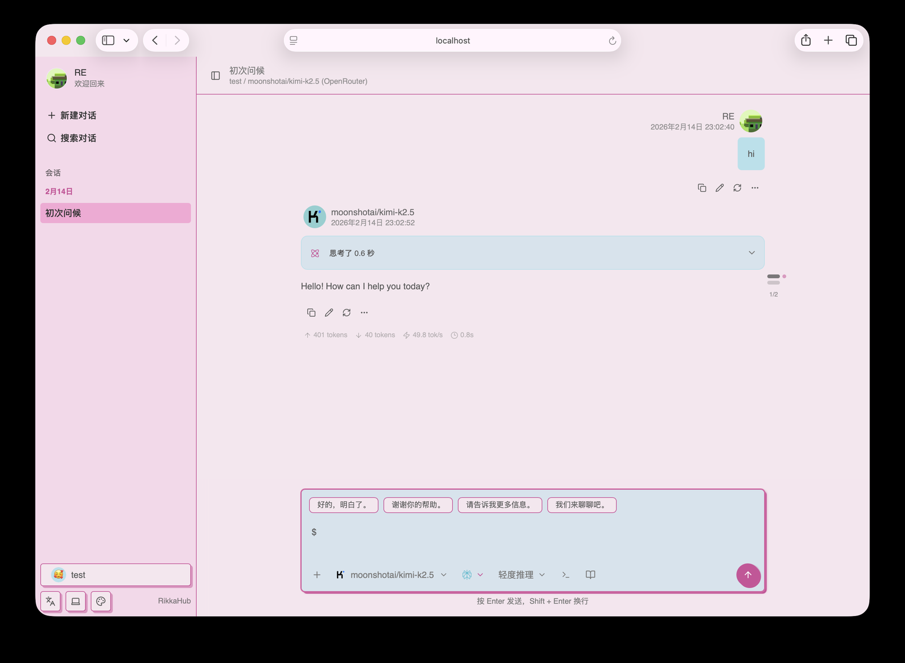

<div align="center">
  
  <h1>FlowBee Chat</h1>
  <p><strong>原生 Android LLM 客户端：多供应商、工具调用、本地优先</strong></p>
  <p>Material You · 多模态输入 · MCP · 工作区 · 语音朗读 · Web 多端</p>

  <p>
    
    
    
    
    
  </p>

  <p>
    <a href="https://flowbee.top">下载</a> ·
    <a href="#架构">架构</a> ·
    <a href="#界面">界面</a> ·
    <a href="#快速开始">快速开始</a> ·
    <a href="#与上游的关系">上游 RikkaHub</a>
  </p>
</div>

> [!NOTE]
> **FlowBee Chat** 是 [RikkaHub](https://github.com/rikkahub/rikkahub) 的二次开发分支，为 FlowBee 服务维护。上游提供了成熟的 Android 聊天客户端底座；本分支完成了 FlowBee 内置供应商、语音、聊天记录导入、品牌化与自动发版等改造。

## 项目定位

目标不是再做一个「套壳聊天框」，而是一个**能长期使用、数据在自己手里、可以接任意模型**的 Android 客户端：

- 一个 App 同时接 OpenAI、Anthropic、Gemini 兼容接口；
- 会话、助手、提示词、模型配置都保存在本地；
- 支持工具调用、MCP、联网搜索、工作区与语音；
- 通过 WebDAV / S3 做备份，不绑定单一云服务。

## 功能

- 🎨 Material You 设计、暗色模式、预测性返回
- 🔄 多供应商：自定义 API / URL / 模型，兼容 OpenAI、Anthropic、Google
- 🖼️ 多模态输入：图片、文本文件、PDF、Docx；支持 OCR
- 🛠️ MCP 服务器与工具调用，工具执行前可人工审批
- 📦 工作区：基于 proot 的 Linux 智能体环境
- 🔍 联网搜索：Exa、Tavily、智谱、LinkUp、Brave、Perplexity 等
- 🧠 记忆、Prompt 变量、助手自定义、消息分支
- 🎙️ TTS 语音朗读：内置音色与自定义音色设计
- 📝 Markdown 渲染：代码高亮、LaTeX、表格、Mermaid
- 🌐 Web 多端访问
- 💾 WebDAV / S3 备份与恢复
- 🤳 供应商配置二维码导入导出
- 📥 支持导入 DeepSeek 官网导出的聊天记录

## 相对上游的定制

| 能力 | 说明 | 主要位置 |
|---|---|---|
| FlowBee 内置供应商 | 首页直接使用 FlowBee 的模型与额度，余额显示账户额度 | `data/flowbee/`、`data/provider/` |
| 语音链路 | 内置 Moss 音色、语音页圆形试听行、MiMo 音色设计，鉴权头改为 Bearer 以适配中转 | `speech/`、`ui/` |
| 聊天记录导入 | 解析 DeepSeek 官网导出的会话并转换为本地消息 | `data/sync/importer/` |
| 品牌化 | 包名 `top.flowbee.chat`、FlowBee 图标与加载动画、Claude 象牙白主题 | `app/`、`common/`、`material3/` |
| 更新与发布 | 自更新通道指向 FlowBee，CI 推送 APK 到 R2，提供 `app/latest.apk` 固定入口 | `.github/workflows/`、`app/build.gradle.kts` |
| 交互调整 | 侧边栏全屏、更新提示改为用户名右侧 badge、设置页警告卡修正 | `ui/` |

## 架构

<p align="center">
  
</p>

消息生成是项目的核心链路：

1. `ChatService.sendMessage()` 取消旧 Job、补齐被打断的工具调用、写入用户消息；
2. `GenerationHandler` 组装系统提示、记忆、上下文与工具定义，进入最多 256 轮的 Step 循环；
3. 输入侧经过 7 个 Transformer（时间、提示注入、占位符、文档、OCR、模板、工作区）；
4. 调用具体 Provider，流式 chunk 经输出 Transformer 实时渲染；
5. 若产生工具调用，按审批状态执行，再把结果写回消息继续下一轮；
6. 结束后保存会话，并异步生成标题与建议。

完整链路见 [docs/references/chat-generation-pipeline.md](docs/references/chat-generation-pipeline.md)。

## 界面

<p align="center">
  
</p>

<p align="center">
  
</p>

## 快速开始

### 环境要求

- JDK 17
- Android Studio（支持 API 37）
- Android SDK 37

### 构建

```bash
git clone https://github.com/leicanxi/flowbee-chat-plus.git
cd flowbee-chat-plus

# Debug APK
./gradlew :app:assembleDebug

# 安装到已连接设备
./gradlew :app:installDebug
```

构建产物位于 `app/build/outputs/apk/debug/app-debug.apk`。

> `app/google-services.json` 是仓库内特意提交的占位配置，仅用于让 Firebase 插件完成构建；正式发布请替换为自己的配置。

### 配置模型

1. 打开 App → 设置 → 供应商；
2. 选择 FlowBee 内置供应商，或新增任意 OpenAI / Anthropic / Gemini 兼容供应商；
3. 填入 Base URL、API Key 与模型名；
4. 回到会话页选择模型即可开始。

## 项目结构

| 模块 | 职责 |
|---|---|
| `app` | 应用入口、导航、主要 UI 与 ViewModel |
| `ai` | Provider 适配、生成循环、Transformer、工具接口 |
| `search` | 联网搜索提供商 |
| `speech` | TTS / 语音能力 |
| `document` | PDF、Docx 等文档解析 |
| `web` / `web-ui` | Web 多端与内置 Web UI |
| `workspace` | proot Linux 工作区 |
| `oauth` | 第三方登录 |
| `videogen` | 视频生成 |
| `common` / `material3` / `highlight` | 公共组件、主题、代码高亮 |

## 设计取舍

- **本地优先**：会话与配置默认落本地数据库，云同步只作为可选备份，App 不依赖后端才能打开历史记录。
- **Provider 抽象**：统一请求 / 响应模型，新增供应商只需实现适配层，不侵入会话逻辑。
- **工具审批**：高风险工具默认需要用户确认，避免模型在用户不知情时执行敏感操作。
- **上下文裁剪**：按消息数量阶梯式裁剪历史，优先保留系统提示、记忆与最近工具结果。
- **可恢复生成**：生成过程是可取消的 Job，取消或进程中断后能补齐未完成的工具调用。

## 与上游的关系

- 上游：[rikkahub/rikkahub](https://github.com/rikkahub/rikkahub)
- 本分支：34 个定制提交，覆盖品牌、FlowBee 供应商、语音、导入、主题与 CI 发版
- 许可证：**AGPL-3.0**，详见 [LICENSE](LICENSE)

上游 README 与社区资源仍然适用；涉及 FlowBee 定制的问题请在本仓库提 Issue。欢迎交流 Android LLM 客户端的架构与工具体验。
